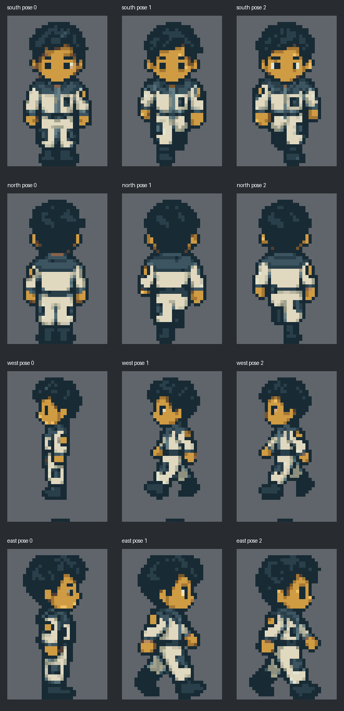

# Generated caretaker — Aseprite MCP audit

This is the generated four-direction player family in `Assets/_Project/Art/SOLITUDE/Characters`, derived from `Tools/ArtSources/SOLITUDE/caretaker-source-v01.png`. The previous audit reviewed the older placeholder instead. Its scale and missing-direction recommendations do not apply to this family.

## Review copy and evidence

[Editable Aseprite clone](generated_caretaker_audit_clone.aseprite) contains the twelve production PNG poses, in south/north/west/east order, three poses each. Each direction has a `_poses` tag for inspection. These tags group distinct poses; they do not reproduce the Unity walk timeline.

Copies of the original PNGs, an exact horizontal frame strip, tool responses, and `provenance.json` are retained beside this report. Import and PNG export ran through Aseprite MCP. All twelve round trips preserved visible RGBA pixels and alpha masks exactly; Aseprite normalized irrelevant RGB values in fully transparent pixels. Source file hashes remained unchanged. No Unity assets, imports, controller, or global MCP settings were modified.

MCP calls: `import_spritesheet`, `get_sprite_info`, `assess_sprite` for all twelve frames with standing/color-vision checks, `extract_palette` with mutation disabled, `add_tag` on the review clone, `validate_loop` for pose comparisons, constrained `validate_sprite_for_game_export`, and `export_png`.

## What already works

- All frames are 32×48 with binary transparency (alpha 0 or 255), point filtering, 32 PPU, and bottom-center pivots.
- The production family includes south, north, west, and east, with idle and two walking poses each.
- All poses have their lowest opaque pixel on row 47. The measured bottom contact row is stable.
- Warm ivory, desaturated steel blue, graphite, warm skin, and restrained utility accents match SOLITUDE's caretaker brief.
- No empty or identical adjacent poses were reported. Tested red-green color-vision models did not report collapsed touching-color pairs.

## Improvements worth making

### 1. Match left/right proportions

West idle occupies 16 pixels of width (x=8–23); east idle occupies 21 (x=5–25), despite both being side profiles 46 pixels tall. The west walking poses occupy 18 pixels, while east occupies 23. That is a material facing-dependent width difference, beyond a tiny shoulder or hand detail. Visually, west idle is unusually thin through the torso, and the side walk poses change the body shape considerably.

Use one consistent side-view construction for head, shoulder, chest, hips, and boots. Mirror it as a comparison/reference, then restore intentional costume asymmetry. Preserve natural arm and leg separation while matching the underlying body proportions. Do not indiscriminately mirror the finished costume.

### 2. Rework the normalization step before regenerating artwork

`OpeningArtImport.WriteNormalized` finds opaque bounds independently for each pose, calculates a separate scale, samples into its new dimensions, and centers the result. This gives a stable bottom edge but does not preserve a common body registration or shared source scale. It can amplify pose-to-pose proportion changes and create uneven pixel clusters.

A future import should use common source registration and dimensions across the family, or consume artwork authored directly at 32×48. Compare the existing source sheet first to distinguish generated inconsistencies from normalization artifacts. Do not change the importer as part of this review.

### 3. Open up the dark masses

The darkest color, `#182b35`, covers about 41–60% of opaque pixels across frames. Hair and boots are deliberately dark, so this is not evidence that the outline alone is too thick. Visually, however, those regions merge into broad dark masses with little readable form at native size, particularly from the back and sides.

Keep graphite/dark blue as the silhouette anchor, but strengthen a small coherent mid-tone ramp in hair and boot planes. Clarify limb separation using value and silhouette where it matters. Avoid treating the MCP's generic percentage threshold as an art requirement or thinning every outline automatically.

### 4. Simplify the tiny fragments selectively

MCP counts 41–97 pixels per frame with no orthogonal neighbor of the same color. There are 15–18 opaque colors per pose, which is a reasonable small palette; the concern is cluster organization rather than the count alone. At 32×48, sleeve highlights, trousers, hair, and boots contain many small contrasting fragments.

Consolidate those into deliberate two- or three-pixel clusters while keeping eyes, badges, and essential seams. Draw and review at native size. Do not run blanket stray-pixel removal: isolated colors can be legitimate features, and this measurement does not mean those pixels are disconnected from the character.

### 5. Refine the walking poses, not the frame count first

The Unity clips use idle → step 1 → idle → step 2 → idle keys at 0, .12, .24, .36, and .48 seconds, with a serialized stop time around .5633 seconds. The review clone instead groups the three distinct source poses at default imported timing, so its uniform-duration warning does not describe Unity playback.

Keep the economical animation if it reads well. Improve opposite arm/leg action and consistent boot and trouser shapes, especially across the profile poses. Evaluate the neutral pose's repeated holds and terminal hold against movement speed before adding frames or changing timing. The measured fixed bottom row is promising, but it does not independently prove that the planted foot stays fixed in-game.

## Warnings that need interpretation

- Every pose touches the bottom canvas edge intentionally. MCP's border-contact warning is expected with the established feet pivot, not automatic evidence of clipping. Keep the floor contact unless actual footwear pixels have been cut off.
- The “off-center” reading includes vertical placement and asymmetric profile silhouettes. Do not center a profile's pixel mass at the cost of a stable foot anchor.
- The “fused masses” heuristic can misread a uniform torso, hair, or a side profile. It supports visual review rather than automatic widening of limb gaps.
- The size/transparency validation passed. The initial absence-of-tags warning concerned the newly assembled review document before tags were added, not production PNGs whose animation lives in Unity.

Recommended first trial: repair side-view body proportions on a second clone and keep the current color family, canvas, and foot baseline. Follow with targeted cluster cleanup and dark-ramp readability. No gameplay capture was taken, so movement-speed and scene-background conclusions remain unverified.
