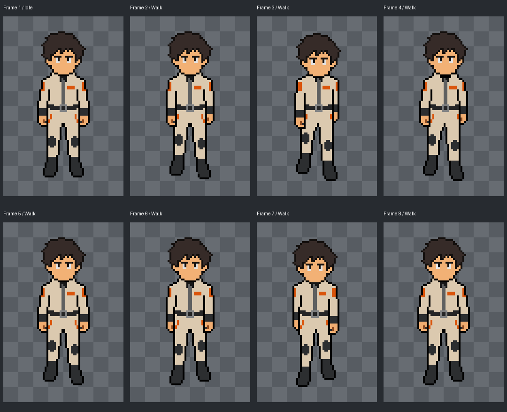

# Caretaker player sprite — Aseprite MCP audit

The existing design is worth keeping. The practical next pass is palette consistency and a more deliberate walk cycle; canvas scale and directional coverage are larger production decisions. No artwork was changed by this audit.

## Scope and provenance

Source: `Assets/_Project/Features/Player/Sprites/SOLITUDE-Caretaker.aseprite`. Its GUID is referenced by `Features/Player/PF_Player.prefab`, which is instantiated in `Scenes/Wakeup.unity`.

Review clone: [player_audit_clone.aseprite](player_audit_clone.aseprite). Original and clone have identical SHA-256 hashes; see [provenance.json](provenance.json). All outputs are outside Assets. The global MCP configuration and Unity imports were not changed.

The configured Aseprite MCP server was launched over stdio with its workspace temporarily pointing at this review folder. Audit calls: `health_check`, `get_sprite_info`, `assess_sprite` on all eight frames (including standing and color-vision checks), `extract_palette` with mutation disabled, `validate_loop` on both tags, `diff_sprites`, `validate_sprite_for_game_export`, and PNG/GIF exports. Exports received independent pixel checks with Pillow.

## Evidence

[Play the downward walk at 4×](walk-down-4x.gif).

| Property | Measured result |
| --- | --- |
| Canvas | 64×96, RGB, eight frames |
| Visible art | Body layer; hidden reference layer retained |
| Tags | Idle_Down: frame 1; Walk_Down: frames 2–8 |
| Timing | 100 ms per frame; walk cycle 700 ms |
| Visible bounds | 25–28 px wide, 78–80 px tall |
| Colors | 14–15 opaque colors per frame; 15 across the animation |
| Transparency | Only alpha 0 and 255 in all exported frames |
| Walk integrity | No empty frames, adjacent duplicates, or duplicated wrap frame |
| Contact row | Walk: 86, 87, 87, 86, 86, 87, 86; idle: 85 |
| Isolated same-color pixels | 23–29 per frame; candidates for inspection, not automatic deletion |
| Color-vision check | No touching-color collapse reported under tested protanopia/deuteranopia models |

## Recommended improvements, in order

1. **Normalize the highlight color across frames.** Most frames use eight pixels of `#e3e3e3`; frame 8 instead uses eight of `#e9e9e9`. Frame 2 mixes seven of the former with one of the latter. MCP frame diffs identify the introduced color. These are very close shades, so visible shimmer is a possibility rather than a proven gameplay defect. Use one deliberate highlight unless the shift expresses lighting or material. Keep skin, orange utility accents, and hair colors distinct. This is the smallest useful trial on a second editable copy.

2. **Review the walk's paired poses and contact baseline.** The seven-frame cycle is valid, but gives an uneven number of poses to distribute between two alternating steps. The visual contact sheet shows relatively restrained arm motion and stronger leg motion. Compare corresponding steps, decide whether the asymmetry is deliberate, and test a balanced six- or eight-frame cycle with clearer arm counter-swing. Keep costume details consistent. Review planted-foot pixels across frames and the idle-to-walk transition: the bottom-most opaque row varies one pixel within the walk and two pixels from idle to the deepest walk pose. This is a source-image observation, not a measured Unity foot slide. Preserve intentional heel lifts and torso bob; do not translate every frame just to make a metric pass. Uniform 100 ms timing is reasonable for locomotion and should only change after checking gait against movement speed.

3. **Resolve the production scale before a major redraw.** SOLITUDE's guide targets approximately 32×48 player frames; this source uses 64×96. The actual figure is narrow and tall (25–28×78–80). The importer uses 32 pixels per unit and the prefab has unit scale, so the unscaled figure is about 2.44–2.5 world units tall. The source's size check fails when given the nominal 32×48 target, but that target is guidance and may admit a documented exception. Confirm scale in the actual scene before deciding. If adopting 32×48, redraw silhouette and details at that resolution: blindly halving this character would leave a 12–14-pixel-wide figure and lose deliberate details. Keep native pixels and foot anchoring.

4. **Add the missing directional artwork when expanding movement presentation.** This source contains only downward idle/walk tags. A full top-down character family should have deliberate up and side silhouettes with matching equipment and proportions. Left/right mirroring is a possible starting point, but must account for asymmetric utility details. Other directional PNGs exist elsewhere in the project; reconcile those with this source before authoring replacements. Missing tags here do not prove missing directional behavior everywhere in the project.

5. **Clean clusters selectively.** The MCP flags 23–29 same-color singleton pixels and many diagonal corners. Eyes, finger highlights, seams, and thin outlines can legitimately trigger those readings. Visually review face, hands, belt, and orange seams at native scale; merge only accidental specks or redundant near-black shades. Avoid bulk `remove_stray_pixels`, automatic symmetry, or automatic limb-gap widening. The current silhouette already separates the arms and legs, and its equipment is intentionally asymmetric.

## Keep

Keep the warm ivory uniform, dark hair and boots, orange utility accents, readable face, crisp transparency, and modest palette. The design fits the practical caretaker role and SOLITUDE's restrained industrial setting. There is no justification from this audit for antialiasing, broad soft shading, or replacing the character concept.

## How to interpret MCP findings

- The idle's horizontal bounds are centered at x=31.5; its `centred=false` reading includes vertical placement in the padded canvas. Do not recenter it blindly.
- `assess_sprite`'s “fused masses” warning is a silhouette heuristic. A uniform torso should contain uninterrupted rows, and the visible limb gaps contradict treating the entire warning as a defect.
- The separator warning cites a 1.1:1 darkest adjacent-color pair. This is not a WCAG compliance verdict for the game character; judge background and internal readability visually.
- Generic export validation with no constraints passed with an empty check list. Only the constrained size/transparency/tag report meaningfully checked project assumptions. The API's top-level `ok=true` means the call completed; the constrained report's `validation.passed=false` is the size verdict.
- No Unity gameplay capture was taken, and not every advanced server tool was exercised against the older local Aseprite development build. The audit and export calls used here succeeded.

Raw tool responses and pixel measurements are retained beside this report. Recommended next experiment: normalize the highlight on another clone, then compare before/after frame diffs and the walk GIF before touching motion or scale.
