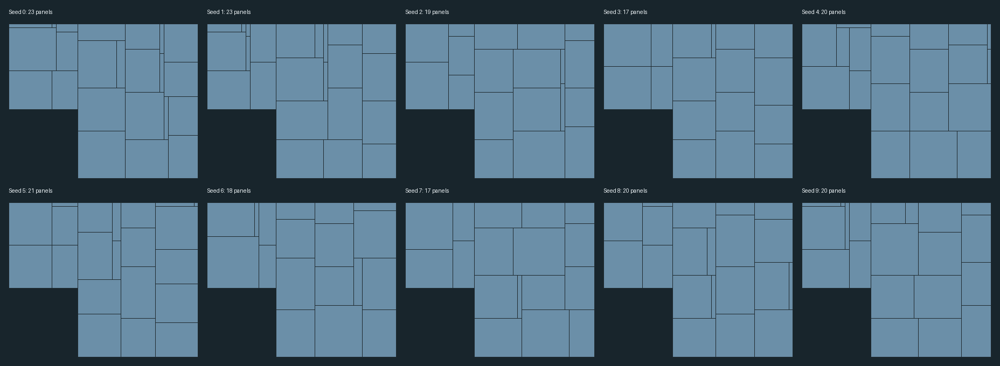

# Cryobay floor-panel seed gallery

Phase 3 Step 1 — isolated exact source-copy fixture, temporary flat floor artwork.

[Native images and comparison sheet](CryobayPaneling/Gallery.svg) · [Recorded settings, rectangles and hashes](CryobayPaneling.json)

The production Wakeup scene was read as serialized text, never opened or edited. Its approved SHA-256 is `69961c0bd0d984539e7c3ef9184b5aa93b74e4f459f81502721675620fda2455`. Only its Floor map supplies occupancy: x=-3..3/y=-5..3 plus x=-7..-4/y=-1..3, exactly 83 unique connected cells. Walls, Collision, props and source Grid transforms are not copied as occupancy. Source scene/metadata and build settings remain byte-identical.

Each seed 0–9 runs through the editor authoring/publication path. The 352×288 native-pixel export has origin (-224,-160); transparent PNGs contain actual prepared seam pixels. Opaque previews combine those pixels with temporary flat floor color. No handcrafted panel variants or inferred equipment reservations are used. Floor/detail/architecture sorting is explicitly 0/1/2, at32PPU with Point filtering and no mipmaps. Saved disposable fixture assets are removed by test cleanup; the scaffold can be recreated with `ShipLayoutSmokeSetup.CreateCryobay` in a fresh GUID-suffixed isolated folder.

| Seed | Panels | Seam pixels | Rectangle SHA prefix | Pixel SHA prefix |
|---|---|---|---|---|
| 0 | 23 | 3373 | `217deb25b92a` | `d93aaced1858` |
| 1 | 23 | 3331 | `e95c5317c546` | `010e4c198dd9` |
| 2 | 19 | 3147 | `23ac195f00f3` | `0b5ddc2af609` |
| 3 | 17 | 3012 | `9e46b486a71e` | `201643fc267d` |
| 4 | 20 | 3193 | `3e01e39df884` | `aafafe8847fa` |
| 5 | 21 | 3222 | `1ac2d39c060b` | `ca1a28c09c03` |
| 6 | 18 | 3099 | `52cf830abe75` | `b2557e6b6d42` |
| 7 | 17 | 3029 | `3de2c3c4e3f1` | `47f3f871e4a0` |
| 8 | 20 | 3258 | `051eb84f5420` | `9976c86957d3` |
| 9 | 20 | 3159 | `3764b427dadd` | `1591f7a03e1e` |

All ten rectangle and pixel hashes are distinct. Focused and full executions reproduce identical records and PNG bytes despite different fixture IDs. Independent pixel membership checks cover all84,992 floor pixels exactly once, with no overlapping interiors or out-of-bounds seam pixels. Prepared seam exports match raster buffers; existing inverse seam/junction tests remain passing in the full suite. Two repeated editor rebuilds retain exact output and resource counts.

Density0 yields10 panels; density1 yields90. Fixed64×64 preferences report11 advisories for constrained packing/residuals. Narrow eight-pixel residual strips are supported and visible; this proof does not promise every panel meets preferred minima.

Verification: focused attempt3 **2/2 Passed**; full RoomAuthoring attempt1 **564/564 Passed**. Earlier focused attempts0/2 and1/2 remain Failed and are retained, followed by human-approved fixture-selection and sorting corrections. Source attribution covers156 scoped files plus340 test/configuration context files. The isolated project's recorded EditorSettings, ProjectSettings and URP differences remain qualification limits.

This is prepared pixel-output evidence, not native Scene/Game camera rendering or camera-motion proof. Integrated Medbay/native visual work remains Phase3 Steps2–3; standalone player qualification remains Phase4. PlayMode was not rerun for this Editor-only step. [Known technical debt](TechnicalDebt.md) remains open: RA-TD-001 is human-deferred; RA-TD-002 is a separate structural follow-up.
