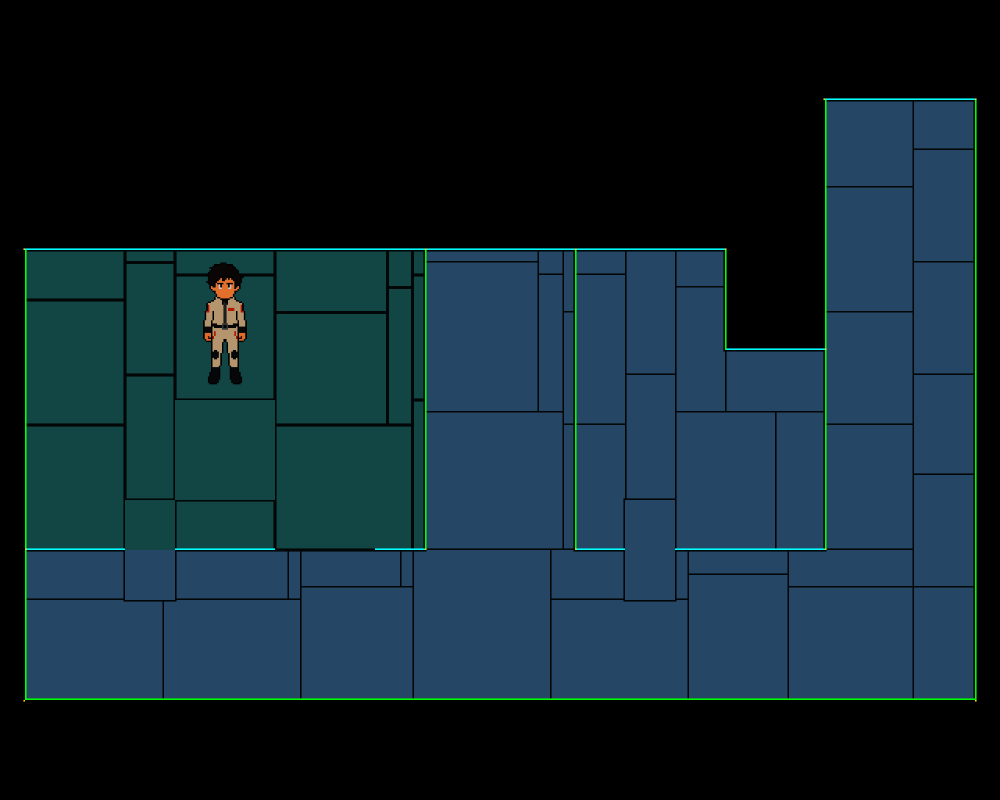

# Floor panel visual alignment — Phase 3 Step 3

Spec revision 5 / approved Plan revision 27. These are temporary-art rendering
and workflow checks, not production art approval or standalone player proof.

## Results

| Check | Result | Concrete evidence |
| --- | --- | --- |
| Focused Edit Mode raster/workflow/authoring | Passed | 59/59; exact inverse pixel oracle, thickness 1–3, exclusions, appearance independence and chunk borders. |
| Final workflow checks, including incompatible PPU recovery | Passed | 2/2; one overlaps the focused run. Invalid wall declaration retains all 48 floor cells; correction restores complete geometry without repainting/resizing. |
| Play Mode floor/blocker compatibility | Passed | 2/2; independent room and layout member, prepared seams cannot supply floor, toggling detail preserves walkability and solid/trigger semantics. |
| Native geometry gallery | Passed | Straight, concave, T, four-way, width transition and eight-pixel remnant; thickness 1/2/3 at 1× and 2×. Every pixel matches the current raster over a flat base; zero nonuniform integer blocks. |
| Continuous-base exclusions | Passed | Horizontal/vertical threshold masks and an equipment reservation, all three thicknesses at 1×/2×. Only detailing is absent; base floor remains continuous. |
| Native camera motion | Passed | 13 four-way frames plus 9 Medbay and 9 exact Cryobay frames. Quarter-pixel requests snap to whole native pixels. Compared frames match the translated baseline exactly over their common viewport. |
| Player, prop and architecture depth | Passed | All 6,016 visible production-player pixels remain unchanged with seams on/off; 4,876 are colored. All 1,024 prop pixels and 1,024 wall-top pixels also remain exact. Original player Sprite, material and Player sorting layer are used. |
| Native incompatible asset declaration | Passed | Cloned style declares 64 PPU for actual 32-PPU north artwork: located North diagnostic. Restoring 32 PPU succeeds; source style/output and clean scene are unchanged. |
| Medbay and shipping data preservation | Passed | Clean saved Medbay and output fingerprint unchanged; the feature worktree's pinned Wakeup scene, metadata, player prefab and build settings retained. No shipping camera/settings changes. |
| Standalone prepared-pixel loading / player build | Not Run | Phase 4 gate. These Play Mode tests are Editor tests, not a standalone build. |
| Broad performance/resource qualification and final independent review | Not Run | Phase 4. Prior scoped reviews do not certify this new step. |

The final source qualification compares all 307 first-party C#/assembly files
with the isolated test project and all 32 RoomAuthoring generation/editor C#
files with the live verification Editor: zero mismatches. The 59-test execution
preceded the additional PPU recovery test; the final two-test workflow execution
qualifies that addition. No generator, runtime, camera, style or saved-scene
implementation was changed in this step.

## Native rendering configuration

Actual running Unity Editor: 6000.6.4f1 on macOS ARM64, Metal; current pipeline:
`UnityEngine.Rendering.Universal.UniversalRenderPipelineAsset`. Disposable
additive review scenes use URP PixelPerfectCamera, assetsPPU 32, PixelSnapping,
no crop, orthographic projection, HDR/MSAA/dynamic resolution off, and no
post-processing. Point ARGB32 review targets are read back to RGBA32 PNGs. A
linear render target permits exact comparison with linear source texture bytes;
this is deliberately qualified separately from arbitrary display color settings.

The geometry camera references 640×192 and renders 1×/2×. Medbay references
640×512; Cryobay 384×320. Motion requests advance 0.25 native pixels per sample,
both axes for the levels. Frames within one snapped camera pixel are identical;
a transition moves the whole image by the expected two output pixels at 2×.
Source PNGs are authoritative; any GIF preview is a viewing aid.

Gallery geometry uses explicit native-pixel masks and current partition/seam/
raster functions with seed 18, version 1, preferred 32–128 pixels and density
0.5. Opaque diagnostic seam ink permits exact color comparison; independent
Edit Mode tests separately establish single-union alpha behavior with translucent
ink. Default 256-pixel chunks cross the long fixtures and negative coordinates.
All captures use Point filtering, no mipmaps and bottom-left native alignment.
The exclusion fixtures represent already resolved eligible masks; actual
connection/reservation domain semantics are separately exercised by the authoring
tests and natively painted Medbay. They do not invent an alternate occupancy map.

Cryobay reads only the exact 83 Floor cells permitted by S61, checking the Wakeup
source digest. No production Grid, walls, props or collision are opened/changed.
The temporary flat floor receives current seed-0 paneling. Medbay renders the
preserved natively painted 176-cell layout with its actual prepared resources,
seeds 0/18/0, seam widths 1/2/1, three explicit connections and Treatment's 2×2
reservation. Its output fingerprint remains
`AA13DA75CBE371C14289FB5C06019AA7D63C6C5772C4123CF9124534EE692896`.

The depth capture copies the production player's Sprite and Sprite-Lit-Default
material, keeping Player sorting order 0. A review-only global 2D light targets
all sorting layers. It instantiates no gameplay scripts. The fixture wall-top
uses its intended higher sorting layer. This establishes appearance/sorting
against detail, not locomotion, Cinemachine tracking or combat behavior.

## Inspectable captures and raw results

- [Geometry results and rectangle records](Native/Phase3Step3Attempt3/Results.json).
  Its initial domain-only threshold and preliminary unlit-player images are
  historical, superseded by the explicit continuous-base/lit-player checks below.
- [Straight](Native/Phase3Step3Attempt3/Straight-1-2x.png),
  [concave](Native/Phase3Step3Attempt3/Concave-1-2x.png),
  [T](Native/Phase3Step3Attempt3/Tee-1-2x.png),
  [four-way](Native/Phase3Step3Attempt3/FourWay-1-2x.png),
  [width transition](Native/Phase3Step3Attempt3/WidthTransition-2-2x.png),
  [eight-pixel remnant](Native/Phase3Step3Attempt3/EightPixelRemnant-3-2x.png).
- [Exclusion results](Native/Phase3Exclusions/Results.json):
  [horizontal](Native/Phase3Exclusions/HorizontalThreshold-2-2x.png),
  [vertical](Native/Phase3Exclusions/VerticalThreshold-3-2x.png),
  [equipment](Native/Phase3Exclusions/EquipmentReservation-1-2x.png).
- [Level-motion and player results](Native/Phase3Levels/Results.json),
  [Cryobay](Native/Phase3Levels/Cryobay83-motion-00.png),
  [Medbay base-only comparison](Native/Phase3Levels/Medbay-player-base.png).
- [Opaque prop and wall-top results](Native/Phase3PropDepth/Results.json),
  [detail visible](Native/Phase3PropDepth/Props-detail.png),
  [base-only comparison](Native/Phase3PropDepth/Props-base.png).

Raw scripts, command envelopes, XML, source hashes and preservation records are
retained under `.qrspi/floor-driven-room-authoring/verification/phase-3-step-3-*`.
All source snapshots are based on clean HEAD
`73a45d7b5f9a5129409e03aa6747d96eb88b1ab1` plus the three recorded test-file
changes; final documentation/image hashes are recorded with the step commit.

Early harness attempts are retained: one rejected CLI argument, one incorrect
post-capture screen-coordinate lookup and a background-color expectation that
omitted Unity's sRGB-to-linear clear-color conversion. Later attempts correct
only the capture harness. No product failure is hidden by those corrections.
Historical incomplete images were moved, with hashes/location record, to ignored
verification storage; they are not presented as final rendering evidence.
The separate production checkout has a different observed Wakeup digest; it was
read only and was not used as fixture input or overwritten. The approved pinned
source in this worktree and its native verification copy remain exact.

## Limits retained

The saved Medbay remains a current IncompletePreview: two unconfigured doorway
frames and 21 residual-size advisories are disclosed temporary-art limitations,
not corrupted floor or missing structural apertures. RA-TD-001 remains open under
its prior human deferral; use one panel-editing Inspector per layout. No blanket
S49 waiver or repaired multi-Inspector coordination is claimed. Final production
artwork, damage and decorative overlays are outside this amended requirement.
